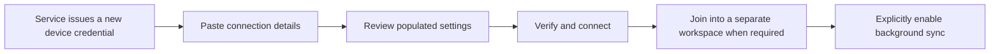

# Explicit workspace connections

The workspace dialog now opens a separate **Sync connection** page. Opening the
page reads local status only. Connecting authenticates the administrator-issued
workspace ID, device ID and credential through `session_info`; it sends no
research. The credential is held in session memory and cleared on disconnect.
Restart requires reconnecting. This is reference/self-hosted sync, not AI login
or a public signup flow.

## Available actions

- **Sync now** operates only on an already capture-bound database whose journal,
  research and capture identities exactly match the authenticated session.
  Existing unbound data is never enrolled or uploaded as a side effect of login.
- **Join into a new workspace** replays the full retained event stream into a
  separate staged database using a newly issued device identity. Local active
  identity reuse and identities already represented as authors in replayed
  history are rejected. Completed metadata is published by atomic no-replace
  directory rename. An existing unrelated directory is never overwritten.
- **Open created workspace** starts a separate app process with an explicit
  data directory. The existing per-workspace single-instance protocol raises an
  already open destination. The original window and drafts remain open. Sync
  credentials and provider environment secrets are not forwarded. Startup checks
  the selected database identity before migrations; no in-process global path
  rebinding occurs. Restored backups remain detached, and opening does not enroll
  them. The opening contract accepts exact paper/deck focus; creation of editable
  recovered copies remains a separate unfinished layer. A build without that
  capability rejects deck focus before launching, without changing either workspace.

The connection dialog disables duplicate actions and exposes cancellation.
Closing during work requests cancellation and waits for the worker to finish.
Changing the endpoint/identity disconnects the previous session immediately.
Late responses cannot acknowledge into a replaced database or a changed session.
An already accepted remote request may finish before cancellation; retry uses the
same operation identity, so this does not create another research version.

## Progress, files and retry

Pending uploads, acknowledged-but-not-received receipts, conflicts and received
metadata are separate counts. A manual pass is bounded by pages, elapsed work
budget and attachment steps. Network requests have the existing transport timeout;
cancellation is cooperative at safe boundaries. No percentage or completion time
is invented for unknown remaining history.

Only an **empty pull** exhausts the observed stream prefix. HTTP may shorten a page
because of event/byte caps; a nonempty short page is not completion. The current
server does not provide a frozen bootstrap high-water token, so later changes
arrive on the next manual sync rather than being implied by a completed join.

PDF and editable-deck manifests upload through the existing verified blob
coordinators before publication. Desired files download independently and become
readable only after verified binding. Unavailable files, missing local storage
registration and transfer failures remain visible pending work. Metadata readiness
is never labelled complete offline availability. Joining registers new local file
paths; the user reconnects in the new window and syncs to download its attachments.

Interrupted joins keep a private deterministic sibling stage and durable cursor.
Reconnect with the same endpoint, workspace/device and destination to resume.
Initialization and final publication use separate atomic directories. Cancellation
after path registration and publication failures are retryable. An unsupported
event fails the batch without advancing past it. Stage metadata contains no token.
Stages are retained for explicit retry; automatic stage expiration/cleanup is not
implemented.

## Remaining release gates

This provides an actual connection, manual sync, new-device join and new-window
journey. The following remain required development work:

- Complete first enrollment of existing research, with the full writer/file
  inventory, consistent baseline capture and independent recovery prerequisites.
- Secure remembered credentials and device issuance/revocation UX. Current device
  issuance remains the service's trusted administrator API; there is no public
  enrollment endpoint or invented third-party OAuth.
- Compatibility/version negotiation, authority rollback/generation protection,
  retention policy and production service deployment/security review.
- Live packaged Windows/macOS/Linux launch and authenticated deployment checks.
  Fixtures cover source/frozen launch commands, cancellation and data isolation;
  they do not prove every packaged platform or external service.

Newer annotation contracts must be present in the receiving build. Unknown kinds
or feature payloads are rejected, never skipped to make the cursor appear current.

## One-paste connection setup (development candidate)

Paste a credential-bearing connection record into **Paste connection details
from your service**, then choose **Use connection details**. The record is parsed
in a guarded background worker using the existing closed `Connection` format;
this neither contacts the service nor authorizes research synchronization.
Review the populated endpoint/workspace/device, then explicitly verify and
connect. Automatic synchronization is a separate opt-in. Manual fields remain
available, including credentials too large for the native-vault record format.



The closed JSON format is version 1, with exactly `format`, `endpoint`,
`workspace_id`, `device_id` and `token`. It uses the existing vault record's size,
identifier, credential and HTTPS/literal-loopback URL validation; duplicate JSON
fields are rejected. An example shape, with deliberately unusable placeholders:

```json
{"format":1,"endpoint":"https://sync.example.org","workspace_id":"example-workspace","device_id":"new-mac-device","token":"REPLACE_WITH_NEW_DEVICE_TOKEN"}
```

This is private connection material, not a public share link or a signed pairing
code. Receive it only from the operator of the intended service. Do not put it in
issues, research packages or documentation. Each device requires its own issued
identity/credential; copying the desktop's identity is not enrollment. This UI
adds no issuance, OAuth, remote HTTPS deployment or account recovery endpoint.
No actual service configuration or credential is created by reading this guide.

The input is masked and cleared once parsing starts; accepted credentials remain
masked in the manual form until explicit verification clears them. Pending parse
blocks repeated activation, and cancel/close/workspace changes reject late
results. Invalid records preserve existing fields and do not disconnect a
verified route. A successful load stops the old route before replacing fields.
